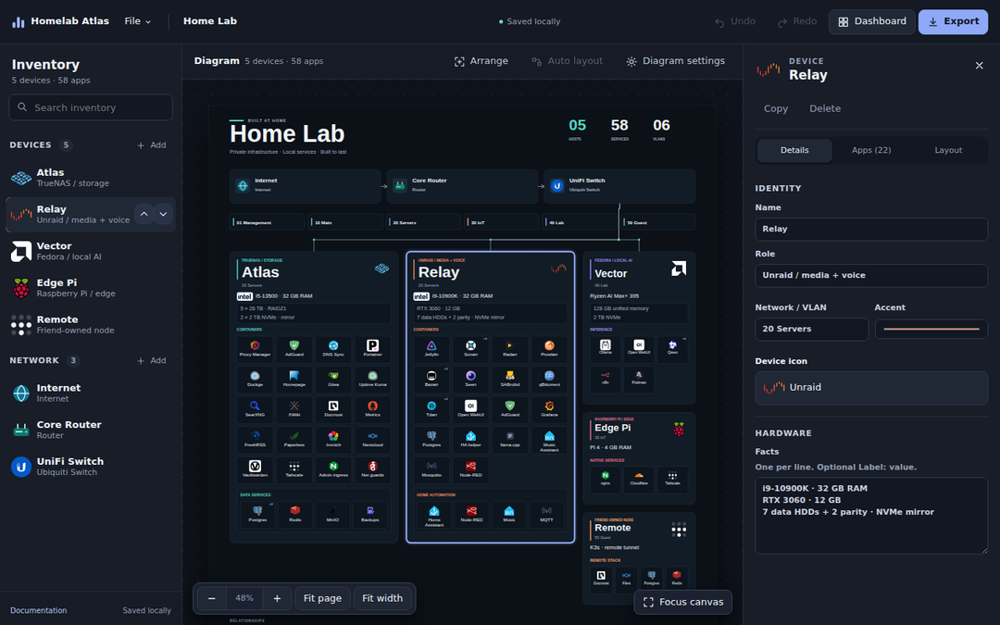

<div align="center">
  

# Homelab Atlas

A self-hosted app for making homelab diagrams.

[](https://github.com/AuthorShin/homelab-atlas/actions/workflows/ci.yml)
[](https://authorshin.github.io/homelab-atlas/)
[](https://github.com/AuthorShin/homelab-atlas/releases/latest)
[](https://github.com/users/AuthorShin/packages/container/package/homelab-atlas)
[](LICENSE)

[Documentation](https://authorshin.github.io/homelab-atlas/) · [FAQ](https://authorshin.github.io/homelab-atlas/faq) · [Releases](https://github.com/AuthorShin/homelab-atlas/releases) · [Docker images](https://github.com/users/AuthorShin/packages/container/package/homelab-atlas)
</div>

I posted a diagram of my homelab on Reddit and someone asked how they could make one too. That's where this project started. I wanted a way to add machines and apps, get the logos in, and update the diagram as things changed.

Atlas lays out your diagram automatically, with optional manual positioning and sizing when you want to adjust the composition. Add your servers, services, and network gear, add optional links to the services you want to reach, then export a PNG or SVG for your docs or a post. The app runs locally and doesn't need an account or an LLM. The same project can power a private browser dashboard with clickable service tiles.



## Run it

You'll need Docker with Compose v2:

```sh
curl -fsSLO https://github.com/AuthorShin/homelab-atlas/releases/download/v0.12.0/compose.release.yaml
docker compose -f compose.release.yaml up -d
```

Open `http://localhost:8080`. This uses the `0.12.0` image and only listens on the machine running Docker. Images are available for Linux AMD64 and ARM64.

For access from another computer, updates, or running without Docker, see the [setup guide](https://authorshin.github.io/homelab-atlas/getting-started). The [release page](https://github.com/AuthorShin/homelab-atlas/releases/latest) has the portable ZIP, Compose file, and checksums.

## Making a diagram

Open **File** and start with **Load example** to see how it works, or **Start empty** for your own lab. Add devices, fill in whatever hardware details you want to show, and group the services running on each one. Visual logo pickers are searchable and work offline. Click a device icon or an existing service logo to replace it.

You can upload PNG, JPG, WebP, or SVG logos up to 2 MB, preview their contrast background, and reuse them across devices, services, and network nodes. SVG uploads are converted to PNG, and stored images are at most 512px. They stay in project JSON and work offline and in exports. The bundled catalog still includes 27 provider marks. Atlas starts with an automatic layout; **Arrange** in the canvas header lets you move or resize device cards. **Export** previews and downloads a PNG or SVG, with network details hidden by default and optional literal terms for custom names. Use **File → Save project** to download a JSON copy you can edit later.

Give a service an optional `http://` or `https://` link in its **Apps** tab. Open **Dashboard** in the top bar for a read-only view of the same project where linked service tiles open in a new tab. Links are dashboard-only and never appear in SVG or PNG exports. Use **File → Save as browser default** to choose the project that opens when this browser has no autosaved project, and **Clear browser default** to remove it.

The [editor guide](https://authorshin.github.io/homelab-atlas/editor) covers the controls, the [dashboard guide](https://authorshin.github.io/homelab-atlas/dashboard) explains links and the browser default, and the [networking guide](https://authorshin.github.io/homelab-atlas/networking) explains connections and VLANs.

## A few things to know

- **Save a JSON backup.** Autosave lives in your browser, not the container. Clearing browser data, using private browsing, or opening Atlas at a different hostname or port can make your project appear missing. A PNG or SVG can't be imported as an editable project.
- **The browser default is separate from autosave.** Save a default to use a project as the starting point on this browser origin. Atlas only falls back to it when no autosaved project exists; editing the default in the editor still creates a normal autosave.
- **Service links stay in the dashboard.** They are stored in project JSON and browser storage, open only when clicked, and are deliberately left out of SVG and PNG exports.
- **Connections are logical relationships.** They don't represent individual switch ports, and network cards stay in the automatic header even when you arrange device cards.
- **There's no login system.** Keep it on localhost or a trusted LAN. Don't expose it directly to the internet.
- **Export filtering is intentionally narrow.** It hides addresses, URLs, emails, and terms you list from SVG and PNG images. It does not change saved JSON or text baked into uploaded logos.

More detail is in the [backup guide](https://authorshin.github.io/homelab-atlas/sharing), [privacy page](https://authorshin.github.io/homelab-atlas/privacy), and [troubleshooting guide](https://authorshin.github.io/homelab-atlas/troubleshooting).

## Bugs and contributions

This is still an early version. If something breaks or a layout looks wrong, [open an issue](https://github.com/AuthorShin/homelab-atlas/issues) with a screenshot and steps to reproduce it. Remove private details from anything you attach.

PRs are welcome. [CONTRIBUTING.md](.github/CONTRIBUTING.md) has the checks to run, and the [development docs](https://authorshin.github.io/homelab-atlas/development) explain the code and logo catalog. Please report security problems privately using [SECURITY.md](.github/SECURITY.md).

If you'd like to support the project, you can [buy me a coffee](https://www.buymeacoffee.com/aiden0rchad).

## License

The code is [MIT licensed](LICENSE). App and hardware logos belong to their respective owners and keep their original licenses. Attribution is in [THIRD_PARTY_NOTICES.md](docs/THIRD_PARTY_NOTICES.md).
